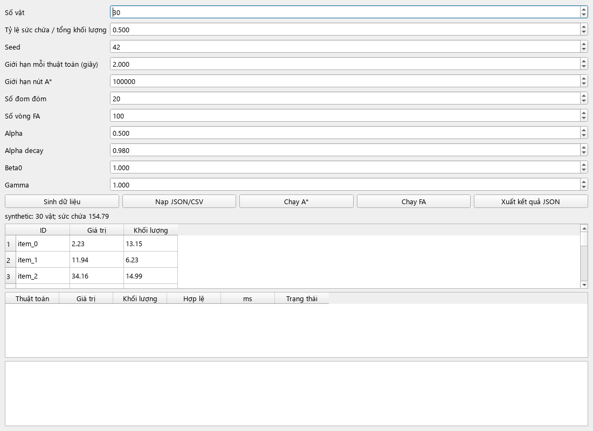

# Ứng dụng thuật toán A* và thuật toán đom đóm (Firefly Algorithm) cho bài toán cái túi (Knapsack problem)

Đồ án Trí tuệ nhân tạo – Trường Công nghệ và Thiết kế, ĐH Kinh tế TP.HCM.
Giảng viên: TS. Đặng Ngọc Hoàng Thành. Khoa học dữ liệu, K50.
Phần TV4: Tiến Tài.

## Cài đặt và chạy

Python 3.10 trở lên, khuyến nghị môi trường ảo:

```powershell
python -m venv .venv
.venv\Scripts\Activate.ps1
python -m pip install -r requirements.txt
python main.py
python -m unittest discover -v
```

GUI cần PySide6; chạy benchmark không cần GUI. Form cho phép sinh dữ liệu với seed,
nạp JSON/CSV, xem vật và sức chứa, chọn giới hạn A*, cấu hình FA, chạy từng thuật toán
trên cùng dữ liệu rồi xuất JSON. Dữ liệu CSV dùng định dạng trong `docs/DATA.md`.
Nút nạp/sinh/chạy/xuất bị khóa khi luồng nền đang chạy; chờ hoàn tất trước khi đóng.
Các bảng chỉ đọc; đổi dữ liệu sẽ xóa kết quả cũ. Chi tiết hiển thị vật chọn và metrics,
bao gồm lịch sử hội tụ nếu thuật toán cung cấp.

## Thực nghiệm tái lập

```powershell
python -m experiments.benchmark --runs 10 --seed 42 --time-limit 2 --output experiments/results/latest
```

Thiết kế: 3 cỡ (10, 30, 100 vật) × 3 tỷ lệ sức chứa (0.25, 0.5, 0.75) × 3 seed dữ liệu.
A* chạy một lần mỗi instance; FA chạy 10 lần với seed liên tiếp. Cả hai có cùng giới hạn
thời gian, A* thêm giới hạn 100000 nút; FA mặc định 20 cá thể, 100 vòng. Đây là so sánh
với ngân sách trần tương đương, không có nghĩa thời gian sử dụng thực tế bằng nhau.
Chỉ có A* và FA trong bảng. Không thêm thuật toán giải ngoài đề tài.

Đầu ra: records CSV/JSON, summary CSV/JSON, metadata môi trường/cấu hình và từng bộ dữ liệu.
Thống kê theo instance và thuật toán: số lần hợp lệ, giá trị trung bình/độ lệch chuẩn mẫu/tốt nhất,
thời gian trung bình/độ lệch chuẩn, gap trung bình và số lần đạt tối ưu.
`gap = 100 × (V_A* − V) / V_A*`, chỉ khi A* xác nhận `optimal`; nếu tối ưu bằng 0 thì gap=0.
Khi A* hết thời gian/nút, gap để trống. Kết quả bị lỗi/thiếu thuật toán dùng null và bị loại
khỏi thống kê; mã thoát benchmark là 2 nếu có lần thiếu/lỗi. Thời gian một lần A* chỉ có tính
mô tả; nên lặp lại toàn bộ thí nghiệm để đánh giá độ nhiễu thời gian. Không suy rộng kết luận
cho mọi phân phối dữ liệu từ bộ sinh uniform này.

**Trạng thái thực tế:** nhánh gốc hiện có hai solver dạng `NotImplementedError` của TV2/TV3.
`experiments/results/availability` ghi 108 lần thử trên 27 instance (FA 3 lần): tất cả pending,
không phải kết quả hiệu năng. Chưa thể kết luận thuật toán nào tốt hơn hoặc demo nghiệm thật.
Sau khi ghép solver, chạy lại lệnh 10 lần/FA và cập nhật phần kết quả trong báo cáo/slide.
Các kiểm thử dùng mock kiểm tra cơ chế tích hợp, không chứng minh chất lượng solver.

## Phân công và bàn giao

| Thành viên | Phạm vi |
|---|---|
| TV1 Quỳnh Trâm | core, DATA, datasets, test_core; Mô hình và Dữ liệu |
| TV2 Nhật Mai | A*, main, requirements, gitignore, test_astar; phần A* |
| TV3 Bảo Ngân | FA, SUMMARY, test_firefly; phần FA |
| TV4 Tiến Tài | gui, experiments/results, test_integration, README; GUI/Thực nghiệm và hỗ trợ ghép |

Bản thảo báo cáo: `experiments/results/REPORT_TV4.md`. Nội dung slide và lời dẫn:
`experiments/results/SLIDES_TV4.md`. Không thay đổi solver của thành viên khác.
Chưa có mẫu báo cáo chính thức trong repo; phần TV4 cần ghép vào mẫu của giảng viên.

## Turnitin và điều kiện nộp

Ghép các phần báo cáo, thống nhất tên đề tài, ký hiệu, mục lục, bảng/hình có giải thích
và trích dẫn nguồn thực sự sử dụng. Kiểm tra bằng Turnitin với cấu hình mặc định,
xem xét từng đoạn trùng và sửa cách diễn đạt/trích dẫn dựa trên hiểu biết; kiểm tra lại
đến khi tỷ lệ lặp **dưới 30%**. Lưu kết quả chính thức rồi nối file vào cuối báo cáo.
Chưa thực hiện kiểm tra Turnitin; chưa có tài khoản, bản ghép cuối và kết quả chính thức.
Không được coi ghi chú này là chứng nhận tỷ lệ lặp hoặc thay bằng ảnh tự tạo.

Slide trình chiếu trên trình duyệt: [slides_tv4.html](experiments/results/slides_tv4.html). Dùng phím trái/phải hoặc PageUp/PageDown; có nút in/lưu PDF.


